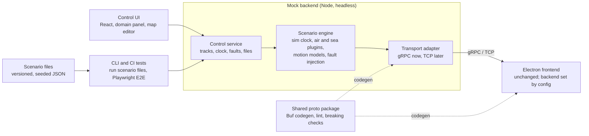

# Mock Track Backend — Spec

Nov 1, 2026 · Sebastian Billing

## Overview

Build a standalone mock backend that generates air and sea tracks from scenarios drawn on a map. It streams them over gRPC (ConnectRPC) to the existing Electron/React tracking frontend, as a drop-in replacement for the real backend.

### Goals

- Developers and testers build scenarios on a map (domain, waypoints, speeds) and stream them to the frontend without the real backend.
- The frontend is exercised under realistic and faulty conditions: noise, gaps, disconnects, errors and high track counts.
- The mock runs headless in CI, so end-to-end tests drive scenarios through an API instead of the UI.
- Every scenario is reproducible from a file and a seed.

### Non-goals

- Physically accurate flight or ship dynamics. Simple kinematics are enough.
- Reproducing backend logic beyond what the track stream exposes (for example sensor fusion).
- Changing the frontend, other than pointing it at a different endpoint through config.

### Reading this spec

Requirements carry IDs (ARC-1, MOT-3) so plans, tasks and PRs can reference them. Names proposed here (packages, services, files) should be aligned with existing repo conventions. Items under Open questions must be answered from the existing frontend and backend code before the affected phase starts.

## Architecture

The mock is a headless Node engine with a pluggable transport. The control UI, CLI and tests are clients of its control API; the frontend sees only the track stream.



The frontend connects to the transport adapter exactly as it would to the real backend. Only the control UI, CLI and tests know they are talking to a mock.

### Components

| Component | Responsibility | Technology |
| --- | --- | --- |
| Scenario engine | Simulation clock, track state, domain plugins, motion models, message-level faults | Node.js, TypeScript |
| Transport adapters | Deliver track events to subscribers; connection-level faults; metrics | gRPC via `@connectrpc/connect-node` (v1), in-memory (tests), TCP via Node `net` (later) |
| Control service | Mock-only API: tracks, clock, faults, scenario files, load generator | ConnectRPC |
| Control UI | Domain panel, map, scenario controls, message log | React, TypeScript, Vite; same map library as the frontend |
| CLI | Runs a scenario file headless; selects transport and ports | Node.js |
| Shared proto package | Track and control protos, generated code | Buf, protobuf-es |

### Requirements

- **ARC-1** The engine runs without any UI, as a Node process and as a Docker image.
- **ARC-2** The control UI and tests change engine state only through the control service.
- **ARC-3** By default the control UI is a browser app served by the engine process. Wrapping it in Electron is allowed but must not change the engine.
- **ARC-4** Proposed package layout, to be aligned with the existing repo: `packages/proto`, `packages/engine`, `packages/transports`, `packages/control-ui`, `scenarios/`.
- **ARC-5** Ports for each transport and for the control service are set by CLI flag or environment variable.

## Contract and transport

The mock implements the real backend's existing `.proto` services unchanged. The transport sits behind an adapter, so gRPC can later be replaced or joined by raw TCP without touching the engine.

### Contract

- **PRO-1** Track messages are generated from the same `.proto` files as the real backend and the frontend. No hand-written copies of messages.
- **PRO-2** Protos live in one shared package or Buf module. CI runs `buf lint` and `buf breaking` against the main branch.
- **PRO-3** Mock-only APIs (the control service) live in a separate proto package, for example `mock.control.v1`, which the frontend never imports.

### Transport abstraction

gRPC is the transport today. Raw TCP may replace it or run alongside it later, so no part of the engine may depend on gRPC.

- **TRN-1** The engine emits transport-neutral track events (internal TypeScript types). It has no imports of ConnectRPC, gRPC or socket code.
- **TRN-2** A shared encoder maps track events to the protobuf messages from PRO-1. Every transport reuses it, so payloads are identical across transports. If TCP ends up with a different payload format, a second encoder is added.
- **TRN-3** Each transport is an adapter implementing one interface: start and stop, subscriber connect and disconnect, send, metrics, and fault hooks.
- **TRN-4** The transport is chosen by config or CLI flag (`--transport grpc`, later `--transport tcp`). Several adapters can run at once, each on its own port.
- **TRN-5** Faults are defined in transport-neutral terms (disconnect, latency, error). Each adapter maps them: gRPC to status codes and stream cancellation, TCP to socket close or reset.
- **TRN-6** v1 ships the gRPC adapter plus an in-memory adapter used by engine tests. The in-memory adapter proves the engine runs with no network transport at all.
- **TRN-7** The control service stays on ConnectRPC whatever the track transport is, since only the mock UI and tests use it.
- **TRN-8** Raw TCP is a byte stream, so a future TCP adapter needs explicit message framing, typically a length prefix before each protobuf message. The framing is an open question.

Proposed adapter interface:

```ts
interface TransportAdapter {
  readonly id: string;                        // "grpc", "tcp", "memory"
  start(config: TransportConfig): Promise<void>;
  stop(): Promise<void>;
  onSubscriber(cb: (sub: Subscriber) => void): void;
  send(sub: Subscriber, event: TrackEvent): Promise<void>;
  applyFault(target: Subscriber | "all", fault: TransportFault): void;
  metrics(): TransportMetrics;                // clients, msgs/s, buffer depth
}

type TransportFault =
  | { kind: "disconnect" }
  | { kind: "latency"; ms: number; jitterMs?: number }
  | { kind: "error"; code: string };          // gRPC status name, or TCP reset
```

Frontend note, outside this spec: the frontend needs a matching transport layer to switch to TCP. Electron's renderer cannot open raw TCP sockets, so a TCP client would live in the main process (Node `net`) and pass data to the renderer over IPC.

### gRPC adapter (v1)

- **GRP-1** The adapter serves the protocol the frontend uses against production. A connect-node server can serve gRPC, gRPC-Web and Connect together; enable all three by default, with a flag to restrict to one.
- **GRP-2** Electron's renderer cannot speak native gRPC, because fetch does not expose HTTP/2 trailers. Confirm whether the frontend calls from the renderer (gRPC-Web or Connect) or from the main process (gRPC over HTTP/2).
- **GRP-3** Plain gRPC without TLS needs HTTP/2 cleartext (h2c) on the server. TLS is optional, matching production.
- **GRP-4** Host and port are set by config, so the frontend switches between mock and real backend with no code change.
- **GRP-5** The adapter respects client cancellation and deadlines.

### Stream semantics (all transports)

- **STR-1** On connect, a subscriber gets what the real backend sends: a snapshot of current tracks followed by updates, or updates only.
- **STR-2** Track lifecycle (created, updated, dropped or lost) is signalled the way the real API signals it.
- **STR-3** Reconnect behaviour (resume, or fresh snapshot) mirrors the real backend.
- **STR-4** Every concurrent subscriber gets the full stream, and a late joiner gets correct current state.
- **STR-5** A slow subscriber never blocks others. Each has a bounded buffer; on overflow the oldest updates are dropped and logged.

### Units and conventions

These are stated in proto comments and enforced by the mock. If the existing protos already use other conventions, those win and are recorded here instead.

| Quantity | Convention |
| --- | --- |
| Position | WGS84 latitude and longitude, decimal degrees |
| Altitude | Meters; reference (MSL or barometric) stated in the proto comment |
| Speed | Meters per second over ground |
| Heading and course | Degrees 0–360 from true north |
| Time | `google.protobuf.Timestamp`, in simulation time |
| Track ID | Stable string, unique within a scenario run |

## Domains and motion

Each domain (air and sea in v1, others later) is a plugin that owns its motion model, defaults and identity attributes. Routes are waypoint polylines, not just a start and an end.

### Domain plugins

- **DOM-1** Air and sea ship in v1. Adding a domain (for example land vehicles or drones) needs no change to the engine core, the UI framework or other domains.
- **DOM-2** The left panel of the control UI lists domains from the plugin registry.
- **DOM-3** A plugin defines its default parameters, its identity attributes, its icon, its motion model and how its state maps to track events.

Proposed plugin interface:

```ts
interface DomainPlugin {
  id: string;                              // "air", "sea"
  displayName: string;
  icon: string;
  defaults: TrackDefaults;                 // speed, update interval, altitude, turn rate
  attributes: AttributeField[];            // callsign, ICAO address, MMSI, name
  createMotion(spec: TrackSpec): MotionModel;
  toEvent(state: TrackState, simTime: Date): TrackEvent;
}

interface MotionModel {
  stateAt(simTimeMs: number): TrackState | "finished";
}
```

### Motion

- **MOT-1** A route is a polyline of two or more waypoints. The current start-and-end flow is the two-point case.
- **MOT-2** Speed is set per leg, plus altitude per leg for air.
- **MOT-3** Positions are interpolated along geodesics (great-circle), and routes crossing the antimeridian work. Use a tested geo library rather than hand-written math.
- **MOT-4** Simple kinematics apply: maximum turn rate, acceleration, and climb or descent rate, so heading and speed change smoothly at waypoints.
- **MOT-5** Each track has an end-of-route behaviour: hold position, loop the route, or drop the track.

### Domain defaults

Defaults are approximate and editable per track. Update intervals follow the real-world systems the data imitates.

| Domain | Default speed | Update interval | Identity attributes |
| --- | --- | --- | --- |
| Air | 230 m/s cruise | About 1 s (ADS-B-like) | Callsign, ICAO 24-bit address |
| Sea | 8 m/s | 2–10 s underway, 3 min at anchor (AIS-like) | MMSI, vessel name |

## Simulation clock and lifecycle

All motion and message timestamps run on a simulation clock that can be paused, stepped and scaled, independent of wall time. A ship route that takes hours can then be tested in minutes.

### Clock

- **CLK-1** Controls: play, pause, step (default step 1 s, configurable) and reset to the scenario start time.
- **CLK-2** Time scale from 0.1× to at least 60×, changeable while running.
- **CLK-3** Message timestamps use simulation time. Each scenario sets its start time; the default is the wall time when it starts.
- **CLK-4** Each track emits at its own interval in simulation time. Updates leave the engine in simulation-time order unless a fault reorders them.

### Scenario lifecycle

- **LIF-1** Scenario states: draft, running, paused, stopped. Paused returns to running; stopped can be reset to draft.
- **LIF-2** Tracks can be added, edited (waypoints, speeds) and removed while a scenario runs. Changes apply from the current simulation time.
- **LIF-3** Each track can start at an offset from scenario start, so tracks appear at different times.
- **LIF-4** One scenario holds any number of tracks across all domains.

## Fault injection

Faults are the mock's main value: every fault can be switched on per track or globally, from the UI, the control API and scenario files.

| Fault | Parameters | What it tests in the frontend |
| --- | --- | --- |
| Position noise | Standard deviation, meters | Smoothing, jittery rendering |
| Update interval jitter | ± percent of interval | Timing assumptions |
| Gap or dropout | Duration, probability | Stale-track handling |
| Track lost and reacquired | Lost duration; same or new track ID | Track lifecycle, ID handling |
| Duplicate messages | Probability | Idempotent updates |
| Out-of-order messages | Probability, maximum delay | Ordering by timestamp |
| Added latency | Fixed ms plus jitter | Latency tolerance |
| Disconnect | At time T, or every N seconds | Reconnect logic |
| Transport error | gRPC: status code (`UNAVAILABLE`, `DEADLINE_EXCEEDED`, `INTERNAL`); TCP: connection reset | Error handling, retries |
| Invalid data | NaN, out-of-range latitude or longitude, missing optional fields | Input validation |

- **FLT-1** Faults are data (type, parameters, scope, schedule), so they serialize into scenario files and the control API.
- **FLT-2** Message-level faults (noise, gaps, duplicates, reordering, invalid data) run in the engine and work for every transport. Connection-level faults (latency, disconnect, transport error) go through the adapter hooks in TRN-5.
- **FLT-3** All randomness comes from the scenario seed.
- **FLT-4** The message log marks every message a fault changed, dropped or added.

## Load generation

A generator spawns many random tracks in a map area, to test whether the frontend's map rendering and React state handling keep up at scale.

- **LOD-1** Inputs: track count (1 to 10,000), domain mix (for example 70% air, 30% sea), an area drawn on the map or given as a bounding box, and speed ranges.
- **LOD-2** Generated tracks get random waypoint routes inside the area.
- **LOD-3** Generation is seeded, so the same inputs produce the same tracks.
- **LOD-4** Target: the engine sustains 5,000 tracks at 1 update per second on a developer laptop without falling behind simulation time. It reports actual against target message rate.
- **LOD-5** Generated tracks can be saved as a scenario file.

## Scenario files and reproducibility

Every scenario is a version-controlled file, and the same file and seed always produce the same message stream. A bug report can then say "load scenario X, the frontend does Y".

- **SCN-1** Scenario files are pretty-printed JSON (`.scenario.json`) with a stable key order, so they diff cleanly in PRs. Each file sets `$schema` to its JSON Schema in the repo, so editors autocomplete and validate it. Notes go in `description` fields on the scenario and on each track, since JSON has no comments. Recordings and message logs are JSON Lines (`.jsonl`). YAML is not supported.
- **SCN-2** A file holds: schema version and kind (see File versioning), name, description, seed, start time, time scale, tracks (domain, description, attributes, waypoints, per-leg speed and altitude, start offset, end behaviour), faults and load generator settings.
- **SCN-3** Files are saved and loaded from the UI, run from the CLI, and loaded through the control API.
- **SCN-4** Given the same file and seed, the engine emits identical messages in identical simulation-time order. Wall-clock delivery timing may differ.
- **SCN-5** The transport is not part of the scenario file. The same scenario runs unchanged over gRPC, TCP or the in-memory adapter.
- **SCN-6** Example scenarios ship in the repo: basic air, basic sea, mixed faults, and a 5,000-track load test.

Example file (speed in m/s applies to the leg starting at that waypoint; altitude in meters; durations in seconds):

```json
{
  "$schema": "../schemas/scenario.v1.json",
  "schemaVersion": 1,
  "kind": "scenario",
  "createdWith": "mock-backend 0.1.0",
  "name": "ferry-and-flight",
  "description": "One ferry with position noise, one flight, a disconnect at 2 min",
  "seed": 42,
  "startTime": "2026-11-01T08:00:00Z",
  "timeScale": 10,
  "tracks": [
    {
      "id": "ferry-1",
      "domain": "sea",
      "attributes": { "mmsi": "235000001", "name": "Test Ferry" },
      "route": [
        { "lat": 51.12, "lon": 1.33, "speed": 8 },
        { "lat": 50.97, "lon": 1.85 }
      ],
      "endBehavior": "hold"
    },
    {
      "id": "flight-1",
      "domain": "air",
      "startOffsetSeconds": 30,
      "attributes": { "callsign": "TST123", "icao24": "4ca001" },
      "route": [
        { "lat": 51.47, "lon": -0.45, "alt": 0, "speed": 80 },
        { "lat": 51.80, "lon": 1.50, "alt": 9000, "speed": 230 },
        { "lat": 52.31, "lon": 4.76, "alt": 0 }
      ],
      "endBehavior": "drop"
    }
  ],
  "faults": [
    { "type": "positionNoise", "scope": { "tracks": ["ferry-1"] }, "params": { "stdDevMeters": 15 } },
    { "type": "disconnect", "atSeconds": 120 }
  ]
}
```

### File versioning

Every file the mock saves carries a schema version, so files saved today still load after the format changes.

- **VER-1** Every saved file (scenario, exported message log, recording) has the top-level fields `schemaVersion` (integer) and `kind` (`scenario`, `messageLog` or `recording`). Files without them are rejected. In JSON Lines files they sit in a header object on the first line.
- **VER-2** Each kind and version has a JSON Schema in the repo, for example `schemas/scenario.v1.json`. A file is validated against the schema of its own version before anything else.
- **VER-3** Bump rules: adding an optional field with a default does not bump the version. Renaming or removing a field, or changing its unit or meaning, does.
- **VER-4** Every bump ships a migration function from version N to N+1. The loader applies migrations in sequence up to the current version, so a v1 file still loads when the format is at v4.
- **VER-5** A file newer than the running mock supports fails with a clear error naming both versions. The mock never silently drops unknown fields.
- **VER-6** Saving always writes the current version. `mock-backend migrate <file>` and an upgrade action in the UI rewrite old files, so files in the repo can be upgraded in bulk.
- **VER-7** Files record the mock version that wrote them (`createdWith`). It is informational only and never drives parsing.
- **VER-8** Recordings and message logs also record the track proto package and version they were captured with, so replay can refuse a recording from an incompatible contract.
- **VER-9** The repo keeps one fixture file per historical version. CI loads every fixture, migrates it, and compares the result with the expected current-version file.

### Record and replay (later phase)

- **REC-1** Record any outgoing stream, from the mock or the real backend, to a JSON Lines file: a header line, then one message per line in canonical protobuf JSON.
- **REC-2** Replay a recording at a chosen time scale.
- **REC-3** Import recorded ADS-B or AIS data as a scenario, in formats to be decided.

Example recording (`.jsonl`). The message fields follow the real track proto; the ones shown are for illustration.

```json
{"schemaVersion":1,"kind":"recording","createdWith":"mock-backend 0.1.0","trackProto":"example.tracks.v1","scenario":"ferry-and-flight","seed":42}
{"simTime":"2026-11-01T08:00:01Z","trackId":"ferry-1","message":{"trackId":"ferry-1","position":{"lat":51.1201,"lon":1.3312},"speedMps":8,"courseDeg":118.4}}
{"simTime":"2026-11-01T08:00:03Z","trackId":"ferry-1","message":{"trackId":"ferry-1","position":{"lat":51.1198,"lon":1.3321},"speedMps":8,"courseDeg":118.6}}
```

## Control UI

The UI is a domain panel on the left and a map on the right, used to build, run and watch scenarios. It talks only to the control API.

- **UI-1** Left panel: domains from the plugin registry (Air, Sea). Selecting a domain sets the type for new tracks and lists that domain's tracks.
- **UI-2** Map: click to add waypoints (two or more); double-click or Enter finishes the route. Waypoints can be dragged to edit a route, also while running.
- **UI-3** Track editor: identity attributes, per-leg speed and altitude, start offset, end behaviour, and faults for that track.
- **UI-4** Scenario bar: play, pause, step, reset, time scale, simulation clock readout, and save or load a scenario file.
- **UI-5** Live view: tracks move on the map from what was actually sent, after faults, so it can be compared side by side with the frontend.
- **UI-6** Global fault panel with a toggle and parameters per fault type.
- **UI-7** Load generator: draw an area, set count and domain mix, spawn.
- **UI-8** Uses the same map library as the frontend. Where practical, the track rendering component (icon, label, heading) is shared through a common package.
- **UI-9** Shows the active transport and its endpoint, for example "gRPC on localhost:50051".

## Observability

The mock shows exactly what it sent, so a mismatch between mock and frontend can be traced to the sender or the receiver.

- **OBS-1** Message log, per track and global, newest first. Each message is decoded to JSON and can be filtered by track, domain and message type. Fault-altered messages are marked.
- **OBS-2** Connected clients: transport (gRPC, gRPC-Web, Connect, later TCP), connect time, messages sent and buffer depth. Data comes from each adapter's `metrics()`.
- **OBS-3** Rates: actual against target messages per second, and how far the engine lags simulation time.
- **OBS-4** Headless mode writes structured JSON logs to stdout, with the log level set by flag.
- **OBS-5** The message log of a run can be exported as a JSON Lines file. The same format is the input for replay (REC-2).

## Testing and acceptance

Version 1 is done when the frontend runs against the mock with a config change only, and an end-to-end test drives a scenario file in CI.

### Tests

- **TST-1** Unit tests for motion models (distance and time along a route, antimeridian crossing, turn-rate limits), fault transforms, and scenario file validation.
- **TST-2** Determinism: one scenario run twice with the same seed produces identical message streams.
- **TST-3** Contract: a client generated from the shared protos connects over each enabled gRPC protocol and receives tracks.
- **TST-4** Transport isolation: engine tests run on the in-memory adapter. A lint rule (for example ESLint `no-restricted-imports`) fails the build if the engine imports ConnectRPC, gRPC or `net`.
- **TST-5** End-to-end: CI starts the mock headless, loads a scenario through the control API, launches the Electron frontend with Playwright, and checks that tracks appear and move.

### Acceptance criteria

- [ ] The frontend shows mock tracks after changing only its backend endpoint config.
- [ ] A user creates an air track and a sea track with three or more waypoints each, starts the scenario, and sees both move in the mock UI and the frontend.
- [ ] Pause, step and 10× time scale behave correctly in both apps.
- [ ] Every fault in the fault table can be switched on and shows up in the message log.
- [ ] 5,000 generated tracks run at 1 update per second without the engine falling behind.
- [ ] The same scenario file and seed produce an identical message stream on two runs.
- [ ] The engine runs headless in Docker from a scenario file, with no UI.
- [ ] The engine has no transport imports, and the in-memory adapter passes the same engine tests as gRPC.
- [ ] `buf lint` and `buf breaking` run in CI on the shared protos.

## Delivery phases

Build the contract, the transport layer and the headless engine first. The UI stays minimal until the clock, motion and faults exist.

1. **Foundation.** Shared proto package with Buf codegen, lint and breaking checks. Transport adapter interface with gRPC and in-memory adapters. Headless engine, control API, and CLI. Minimal UI: map, add a two-point track, start and stop.
   - Exit: the frontend shows a moving mock track after a config change only.
2. **Motion and clock.** Waypoint routes, great-circle interpolation, kinematics, air and sea plugins, simulation clock controls, versioned scenario files with seed and migrations.
   - Exit: the determinism test (TST-2) passes.
3. **Faults and load.** Fault framework with every fault in the table, load generator, rate metrics.
   - Exit: the fault and load acceptance criteria pass.
4. **Full control UI and CI.** Domain panel, route editing, track editor, scenario bar, live view, message log, client list. End-to-end test in CI.
   - Exit: all acceptance criteria pass.
5. **TCP adapter.** Starts once the TCP wire format and framing are decided. Implements the same adapter interface; the engine does not change.
   - Exit: the end-to-end test passes over TCP with the same scenario files.
6. **Record and replay.** Record streams, replay at a chosen time scale, import ADS-B or AIS recordings.

## Open questions

Answer these from the existing frontend and backend code, or with the team, before the phase that depends on them.

- [ ] Does the frontend call the real backend from the Electron main process (gRPC over HTTP/2) or from the renderer (gRPC-Web or Connect)? Needed for GRP-1 and GRP-2, phase 1.
- [ ] Does the real track stream send a snapshot before updates? How are dropped tracks signalled, and what happens on reconnect? Needed for STR-1 to STR-3, phase 1.
- [ ] Do the existing protos define units, altitude reference and heading reference? If not, who decides?
- [ ] Is TLS used in production, and must the mock support it?
- [ ] Should the control UI be a browser app served by the engine (recommended) or an Electron app? Either way it talks only to the control API.
- [ ] For TCP: will it carry the same protobuf messages, and with what framing (varint length prefix, fixed 4-byte length, or something else)? Who owns that protocol definition? Needed for phase 5.
- [ ] Will the frontend get its own transport abstraction so it can switch between gRPC and TCP? A TCP client would have to run in the Electron main process.
- [ ] Which map library does the frontend use, and can its track layer be shared with the mock UI?
- [ ] Do map tiles need to work offline?
- [ ] Which recorded data formats are available for replay (phase 6)?
