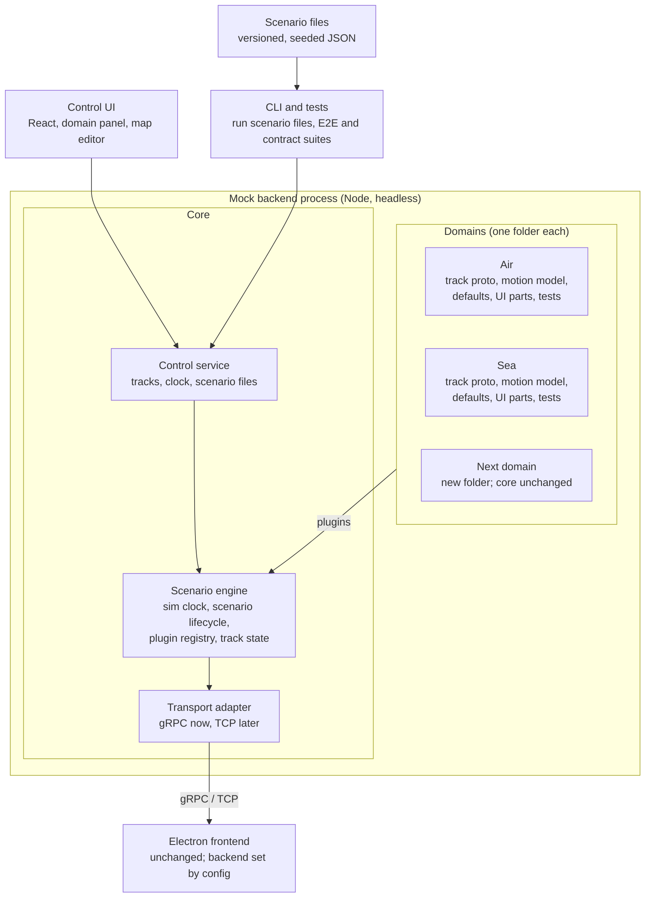

# Mock Track Backend — Spec

Nov 3, 2026 · Sebastian Billing

## Overview

Build a standalone mock backend that generates air and sea tracks from scenarios drawn on a map. It streams them over gRPC (ConnectRPC) to the existing Electron/React tracking frontend, as a drop-in replacement for the real backend. All of it lives in a new `mock-backend/` folder organised by domain, and it is documented in a new `docs/mock-backend/` folder.

### Goals

- Developers and testers build scenarios on a map (domain, waypoints, speeds) and stream them to the frontend without the real backend.
- The mock runs headless in CI, so end-to-end tests drive scenarios through an API instead of the UI.
- Every scenario is reproducible: the same file always produces the same message stream.
- Each domain (air, sea, later others) is self-contained in one folder: protos, logic, UI parts, example scenarios and tests.
- Everything the mock adds to the repo, tests and scripts included, sits under `mock-backend/` or `docs/mock-backend/`.

### Non-goals

- Physically accurate flight or ship dynamics. Simple kinematics are enough.
- Reproducing backend logic beyond what the track stream exposes (for example sensor fusion).
- Changing the frontend, other than pointing it at a different endpoint through config.
- Fault injection (noise, gaps, disconnects, bad data) and load generation (thousands of random tracks). Both are out of scope for this version.

### Reading this spec

Requirements carry IDs (ARC-1, LAY-2) so plans, tasks and PRs can reference them. The folder layout and docs pages named here are required. Align everything else (package names, tooling) with existing repo conventions. Items under Open questions must be answered from the existing frontend and backend code before the affected phase starts.

## Architecture

The mock is a headless Node process: a domain-agnostic core, plus one plugin per domain loaded from `mock-backend/domains/`. The control UI, CLI and tests drive it through the control API; the frontend sees only the track stream.



Adding a domain means adding a folder under `domains/`. The core and the other domains do not change.

### Components

Folders are relative to `mock-backend/`.

| Component | Folder | Responsibility | Technology |
| --- | --- | --- | --- |
| Scenario engine | `core/engine/` | Simulation clock, scenario lifecycle, track state, domain plugin registry | Node.js, TypeScript |
| Transport adapters | `core/transports/` | Deliver track events to subscribers; connection handling; metrics | gRPC via `@connectrpc/connect-node` (v1), in-memory (tests), TCP via Node `net` (later) |
| Control service | `core/control/` | Mock-only API: tracks, clock, scenario files | ConnectRPC |
| Domain plugins | `domains/<domain>/` | Per domain: protos, motion model, defaults, encoder, UI parts, example scenarios, tests | TypeScript, Buf, protobuf-es |
| Control UI | `control-ui/` | App shell: domain panel, map, scenario bar, message log; loads each domain's UI parts | React, TypeScript, Vite; same map library as the frontend |
| CLI | `cli/` | Runs a scenario file headless; selects transport and ports | Node.js |

### Requirements

- **ARC-1** The engine runs without any UI, as a Node process and as a Docker image.
- **ARC-2** The control UI and tests change engine state only through the control service.
- **ARC-3** By default the control UI is a browser app served by the engine process. Wrapping it in Electron is allowed but must not change the engine.
- **ARC-4** Ports for each transport and for the control service are set by CLI flag or environment variable.

## Repository layout

The mock adds two new folders to the repo: `mock-backend/` for code, protos, scenarios, scripts and tests, and `docs/mock-backend/` for documentation. Inside `mock-backend/`, each domain has one folder holding everything that belongs to it.

```text
mock-backend/
├── README.md                  # short pointer to docs/mock-backend/
├── package.json               # scripts: dev, build, lint, test, test:e2e ...
├── buf.yaml                   # one Buf workspace: core and every domain proto folder
├── buf.gen.yaml
├── core/                      # domain-agnostic; never imports from domains/
│   ├── engine/                # sim clock, scenario lifecycle, plugin registry
│   │   └── tests/
│   ├── transports/
│   │   ├── grpc/
│   │   ├── memory/            # in-process adapter used by tests
│   │   ├── tcp/               # later
│   │   └── tests/
│   ├── control/               # control service
│   │   ├── proto/             # mock.control.v1
│   │   └── tests/
│   ├── files/                 # scenario loading, schema versions, migrations
│   │   ├── schemas/           # JSON Schema per file kind and version
│   │   ├── migrations/
│   │   └── tests/
│   └── proto/                 # stream service and messages shared by all domains
├── domains/
│   ├── index.ts               # the list of installed domains
│   ├── air/
│   │   ├── README.md          # links to docs/mock-backend/domains/air.md
│   │   ├── proto/             # air track messages
│   │   ├── src/               # engine plugin: defaults, motion model, encoder
│   │   ├── ui/                # UI plugin: icon, attribute form, track rendering
│   │   ├── scenarios/         # example air-only scenarios
│   │   └── tests/             # unit tests for the air domain
│   └── sea/                   # same layout as air/
├── control-ui/                # React app shell; no domain-specific code
├── cli/
├── scripts/                   # dev and CI helper scripts
├── scenarios/                 # example scenarios that mix domains
└── tests/                     # suites that span core and domains
    ├── e2e/                   # Playwright against the Electron frontend
    ├── contract/              # generated client against each enabled protocol
    ├── determinism/
    └── fixtures/              # one saved file per historical schema version
```

- **LAY-1** All mock code, protos, scenarios, scripts and tests live under `mock-backend/` at the repo root. Nothing is added to the frontend's or the real backend's folders.
- **LAY-2** Each domain has exactly one folder, `mock-backend/domains/<domain>/`, with the subfolders above. Everything specific to that domain lives there and nowhere else.
- **LAY-3** `core/` never imports from `domains/`, and domains never import from each other. Domains may import from `core/`. A lint rule enforces both, for example ESLint `no-restricted-imports` or dependency-cruiser.
- **LAY-4** Each domain exports two entries: `src/index.ts` (engine plugin) and `ui/index.ts` (UI plugin), so the headless engine never loads React code. `domains/index.ts` lists the installed domains; the engine and control UI find domains only through it, never by hard-coded names.
- **LAY-5** Adding a domain means adding its folder, one line in `domains/index.ts`, and its docs page. No file in `core/`, `control-ui/` or another domain's folder changes, with the one possible exception described in PRO-5.

## Documentation

The mock is documented in a new `docs/mock-backend/` folder inside the existing `docs/` folder. The docs, not this spec or code comments, are where a developer learns to run, use and extend the mock.

```text
docs/mock-backend/
├── README.md              # what the mock is, quick start, links to every page
├── spec.md                # this spec
├── architecture.md        # core, domains, transports, control API, diagram
├── repository-layout.md   # the folder tree and what goes where
├── running.md             # start the mock, point the frontend at it, CLI flags, ports
├── control-ui.md          # building and running scenarios in the UI
├── scenario-files.md      # file format, schema versions, migrations, examples
├── transports.md          # gRPC today; how a TCP adapter is added
├── testing.md             # where each test suite lives and how to run it
├── adding-a-domain.md     # step by step: folder, proto, plugins, tests, docs page
└── domains/
    ├── air.md             # messages, units, defaults, identity attributes, motion
    └── sea.md
```

- **DOC-1** `docs/mock-backend/` follows the existing conventions of `docs/`: file format, naming, and any index or navigation file that lists pages.
- **DOC-2** Every domain has a page in `docs/mock-backend/domains/`. The domain folder's `README.md` links to that page instead of repeating it.
- **DOC-3** `adding-a-domain.md` is written while building the air domain, then checked by following it step by step to add the sea domain.
- **DOC-4** A change to a proto, CLI flag, port, file schema or folder rule updates the matching docs page in the same PR. Reviewers check this; if the repo has a PR template, it gets a checklist item for it.
- **DOC-5** Diagrams in the docs are Mermaid, so they render on GitHub and stay editable as text.
- **DOC-6** `testing.md` lists every test command, and every command runs from `mock-backend/`.

## Contract and transport

The mock speaks exactly the contract the frontend expects. Each domain's messages live in that domain's `proto/` folder. The transport sits behind an adapter, so gRPC can later be replaced or joined by raw TCP without touching the engine or the domains.

### Contract

- **PRO-1** Each domain's track messages are defined in `domains/<domain>/proto/` and generated with Buf into that domain's code. No hand-written copies of messages.
- **PRO-2** These protos must match the contract the frontend consumes. If the real backend owns that contract, the domain proto folders are synced copies, and CI fails when they drift (`buf breaking` against the backend's copy). Which side is the source of truth is an open question.
- **PRO-3** The control service proto lives in `core/control/proto/` as its own package, for example `mock.control.v1`. The frontend never imports it.
- **PRO-4** One Buf workspace at `mock-backend/buf.yaml` covers `core/` and every domain proto folder. CI runs `buf lint` and `buf breaking` on all of them.
- **PRO-5** The stream service, and any message shared by all domains, live in `core/proto/`. Each domain proto holds only that domain's messages. If the contract wraps domains in a shared envelope, such as a `oneof` over air and sea tracks, adding a domain also adds one line there. This is the only allowed exception to LAY-5.

### Transport abstraction

gRPC is the transport today. Raw TCP may replace it or run alongside it later, so no part of the engine may depend on gRPC.

- **TRN-1** The engine emits transport-neutral track events (internal TypeScript types). It has no imports of ConnectRPC, gRPC or socket code.
- **TRN-2** Each domain provides an encoder that maps its track events to its protobuf messages. Every transport reuses the same encoders, so payloads are identical across transports. If TCP ends up with a different payload format, each domain adds a second encoder.
- **TRN-3** Each transport is an adapter in `core/transports/<name>/` implementing one interface: start and stop, subscriber connect and disconnect, send, and metrics.
- **TRN-4** The transport is chosen by config or CLI flag (`--transport grpc`, later `--transport tcp`). Several adapters can run at once, each on its own port.
- **TRN-5** v1 ships the gRPC adapter plus an in-memory adapter used by engine tests. The in-memory adapter proves the engine runs with no network transport at all.
- **TRN-6** The control service stays on ConnectRPC whatever the track transport is, since only the mock UI and tests use it.
- **TRN-7** Raw TCP is a byte stream, so a future TCP adapter needs explicit message framing, typically a length prefix before each protobuf message. The framing is an open question.

Proposed adapter interface:

```ts
// core/transports/adapter.ts
interface TransportAdapter {
  readonly id: string;                        // "grpc", "tcp", "memory"
  start(config: TransportConfig): Promise<void>;
  stop(): Promise<void>;
  onSubscriber(cb: (sub: Subscriber) => void): void;
  send(sub: Subscriber, event: TrackEvent): Promise<void>;
  metrics(): TransportMetrics;                // clients, msgs/s, buffer depth
}
```

Frontend note, outside this spec: the frontend needs a matching transport layer to switch to TCP. Electron's renderer cannot open raw TCP sockets, so a TCP client would live in the main process (Node `net`) and pass data to the renderer over IPC.

### gRPC adapter (v1)

- **GRP-1** The adapter serves the protocol the frontend uses against production. A connect-node server can serve gRPC, gRPC-Web and Connect together; enable all three by default, with a flag to restrict to one.
- **GRP-2** Electron's renderer cannot speak native gRPC, because fetch does not expose HTTP/2 trailers. Confirm whether the frontend calls from the renderer (gRPC-Web or Connect) or from the main process (gRPC over HTTP/2).
- **GRP-3** Plain gRPC without TLS needs HTTP/2 cleartext (h2c) on the server. TLS is optional, matching production.
- **GRP-4** Host and port are set by config, so the frontend switches between mock and real backend with no code change.
- **GRP-5** The adapter respects client cancellation and deadlines.

### Stream semantics (all transports)

- **STR-1** On connect, a subscriber gets what the real backend sends: a snapshot of current tracks followed by updates, or updates only.
- **STR-2** Track lifecycle (created, updated, dropped or lost) is signalled the way the real API signals it.
- **STR-3** Reconnect behaviour (resume, or fresh snapshot) mirrors the real backend.
- **STR-4** Every concurrent subscriber gets the full stream, and a late joiner gets correct current state.
- **STR-5** A slow subscriber never blocks others. Each has a bounded buffer; on overflow the oldest updates are dropped and logged.

### Units and conventions

These are stated in proto comments and enforced by the mock. If the existing protos already use other conventions, those win and are recorded here instead.

| Quantity | Convention |
| --- | --- |
| Position | WGS84 latitude and longitude, decimal degrees |
| Altitude | Meters; reference (MSL or barometric) stated in the proto comment |
| Speed | Meters per second over ground |
| Heading and course | Degrees 0–360 from true north |
| Time | `google.protobuf.Timestamp`, in simulation time |
| Track ID | Stable string, unique within a scenario run |

## Domains and motion

Each domain (air and sea in v1, others later) is a plugin in its own folder, `mock-backend/domains/<domain>/`, that owns its protos, motion model, defaults, identity attributes and UI parts. Routes are waypoint polylines, not just a start and an end.

### Domain plugins

- **DOM-1** Air and sea ship in v1, each as a folder under `domains/` (LAY-2). Adding a domain, for example land vehicles or drones, follows `adding-a-domain.md` and needs no change to core or to other domains (LAY-5).
- **DOM-2** The left panel of the control UI lists domains from the plugin registry.
- **DOM-3** A domain's engine plugin defines its default parameters, identity attributes, motion model and encoder. Its UI plugin defines its icon, attribute form and track rendering.

Proposed plugin interface:

```ts
// domains/<domain>/src/index.ts exports one DomainPlugin
interface DomainPlugin {
  id: string;                              // "air", "sea"; matches the folder name
  displayName: string;
  defaults: TrackDefaults;                 // speed, update interval, altitude, turn rate
  attributes: AttributeField[];            // callsign, ICAO address, MMSI, name
  createMotion(spec: TrackSpec): MotionModel;
  toEvent(state: TrackState, simTime: Date): TrackEvent;   // transport-neutral (TRN-1)
  encode(event: TrackEvent): Message;      // this domain's proto message (TRN-2)
}

interface MotionModel {
  stateAt(simTimeMs: number): TrackState | "finished";
}

// domains/<domain>/ui/index.ts exports one DomainUiPlugin
interface DomainUiPlugin {
  id: string;
  icon: string;
  AttributeForm: React.ComponentType<AttributeFormProps>;
  renderTrack: TrackRenderer;              // icon, label, heading on the map
}
```

### Motion

- **MOT-1** A route is a polyline of two or more waypoints. The current start-and-end flow is the two-point case.
- **MOT-2** Speed is set per leg, plus altitude per leg for air.
- **MOT-3** Positions are interpolated along geodesics (great-circle), and routes crossing the antimeridian work. Use a tested geo library rather than hand-written math.
- **MOT-4** Simple kinematics apply: maximum turn rate, acceleration, and climb or descent rate, so heading and speed change smoothly at waypoints.
- **MOT-5** Each track has an end-of-route behaviour: hold position, loop the route, or drop the track.

### Domain defaults

Defaults are approximate and editable per track. Update intervals follow the real-world systems the data imitates.

| Domain | Default speed | Update interval | Identity attributes |
| --- | --- | --- | --- |
| Air | 230 m/s cruise | About 1 s (ADS-B-like) | Callsign, ICAO 24-bit address |
| Sea | 8 m/s | 2–10 s underway, 3 min at anchor (AIS-like) | MMSI, vessel name |

## Simulation clock and lifecycle

All motion and message timestamps run on a simulation clock that can be paused, stepped and scaled, independent of wall time. A ship route that takes hours can then be tested in minutes.

### Clock

- **CLK-1** Controls: play, pause, step (default step 1 s, configurable) and reset to the scenario start time.
- **CLK-2** Time scale from 0.1× to at least 60×, changeable while running.
- **CLK-3** Message timestamps use simulation time. Each scenario sets its start time; the default is the wall time when it starts.
- **CLK-4** Each track emits at its own interval in simulation time. Updates leave the engine in simulation-time order.

### Scenario lifecycle

- **LIF-1** Scenario states: draft, running, paused, stopped. Paused returns to running; stopped can be reset to draft.
- **LIF-2** Tracks can be added, edited (waypoints, speeds) and removed while a scenario runs. Changes apply from the current simulation time.
- **LIF-3** Each track can start at an offset from scenario start, so tracks appear at different times.
- **LIF-4** One scenario holds any number of tracks across all domains.

## Scenario files and reproducibility

Every scenario is a version-controlled file, and the same file always produces the same message stream. A bug report can then say "load scenario X, the frontend does Y".

- **SCN-1** Scenario files are pretty-printed JSON (`.scenario.json`) with a stable key order, so they diff cleanly in PRs. Each file sets `$schema` to its JSON Schema in `core/files/schemas/`, so editors autocomplete and validate it. Notes go in `description` fields on the scenario and on each track, since JSON has no comments. Recordings and message logs are JSON Lines (`.jsonl`). YAML is not supported.
- **SCN-2** A file holds: schema version and kind (see File versioning), name, description, seed, start time, time scale and tracks (domain, description, attributes, waypoints, per-leg speed and altitude, start offset, end behaviour). The seed drives any randomness, such as generated callsigns or MMSIs.
- **SCN-3** Files are saved and loaded from the UI, run from the CLI, and loaded through the control API.
- **SCN-4** Given the same file, the engine emits identical messages in identical simulation-time order. Wall-clock delivery timing may differ.
- **SCN-5** The transport is not part of the scenario file. The same scenario runs unchanged over gRPC, TCP or the in-memory adapter.
- **SCN-6** Example scenarios that use one domain live in that domain's `scenarios/` folder (basic air, basic sea). Scenarios that mix domains live in `mock-backend/scenarios/`.

Example mixed-domain file, `mock-backend/scenarios/ferry-and-flight.scenario.json` (speed in m/s applies to the leg starting at that waypoint; altitude in meters; durations in seconds):

```json
{
  "$schema": "../core/files/schemas/scenario.v1.json",
  "schemaVersion": 1,
  "kind": "scenario",
  "createdWith": "mock-backend 0.1.0",
  "name": "ferry-and-flight",
  "description": "One ferry crossing the Channel and one flight starting 30 s later",
  "seed": 42,
  "startTime": "2026-11-01T08:00:00Z",
  "timeScale": 10,
  "tracks": [
    {
      "id": "ferry-1",
      "domain": "sea",
      "attributes": { "mmsi": "235000001", "name": "Test Ferry" },
      "route": [
        { "lat": 51.12, "lon": 1.33, "speed": 8 },
        { "lat": 50.97, "lon": 1.85 }
      ],
      "endBehavior": "hold"
    },
    {
      "id": "flight-1",
      "domain": "air",
      "startOffsetSeconds": 30,
      "attributes": { "callsign": "TST123", "icao24": "4ca001" },
      "route": [
        { "lat": 51.47, "lon": -0.45, "alt": 0, "speed": 80 },
        { "lat": 51.80, "lon": 1.50, "alt": 9000, "speed": 230 },
        { "lat": 52.31, "lon": 4.76, "alt": 0 }
      ],
      "endBehavior": "drop"
    }
  ]
}
```

### File versioning

Every file the mock saves carries a schema version, so files saved today still load after the format changes.

- **VER-1** Every saved file (scenario, exported message log, recording) has the top-level fields `schemaVersion` (integer) and `kind` (`scenario`, `messageLog` or `recording`). Files without them are rejected. In JSON Lines files they sit in a header object on the first line.
- **VER-2** Each kind and version has a JSON Schema in `core/files/schemas/`, for example `scenario.v1.json`. A file is validated against the schema of its own version before anything else.
- **VER-3** Bump rules: adding an optional field with a default does not bump the version. Renaming or removing a field, or changing its unit or meaning, does.
- **VER-4** Every bump ships a migration function from version N to N+1 in `core/files/migrations/`. The loader applies migrations in sequence up to the current version, so a v1 file still loads when the format is at v4.
- **VER-5** A file newer than the running mock supports fails with a clear error naming both versions. The mock never silently drops unknown fields.
- **VER-6** Saving always writes the current version. `mock-backend migrate <file>` and an upgrade action in the UI rewrite old files, so files in the repo can be upgraded in bulk.
- **VER-7** Files record the mock version that wrote them (`createdWith`). It is informational only and never drives parsing.
- **VER-8** Recordings and message logs also record the proto package and version of each domain they were captured with, so replay can refuse a recording from an incompatible contract.
- **VER-9** `mock-backend/tests/fixtures/` keeps one saved file per historical version. CI loads every fixture, migrates it, and compares the result with the expected current-version file.

### Record and replay (later phase)

- **REC-1** Record any outgoing stream, from the mock or the real backend, to a JSON Lines file: a header line, then one message per line in canonical protobuf JSON.
- **REC-2** Replay a recording at a chosen time scale.
- **REC-3** Import recorded ADS-B or AIS data as a scenario, in formats to be decided.

Example recording (`.jsonl`). The message fields follow the real track proto; the ones shown are for illustration.

```json
{"schemaVersion":1,"kind":"recording","createdWith":"mock-backend 0.1.0","trackProto":"example.tracks.v1","scenario":"ferry-and-flight","seed":42}
{"simTime":"2026-11-01T08:00:01Z","trackId":"ferry-1","message":{"trackId":"ferry-1","position":{"lat":51.1201,"lon":1.3312},"speedMps":8,"courseDeg":118.4}}
{"simTime":"2026-11-01T08:00:03Z","trackId":"ferry-1","message":{"trackId":"ferry-1","position":{"lat":51.1198,"lon":1.3321},"speedMps":8,"courseDeg":118.6}}
```

## Control UI

The UI is a domain panel on the left and a map on the right, used to build, run and watch scenarios. It lives in `control-ui/`, talks only to the control API, and gets every domain-specific piece from the domain folders.

- **UI-1** Left panel: domains from the plugin registry (Air, Sea). Selecting a domain sets the type for new tracks and lists that domain's tracks.
- **UI-2** Map: click to add waypoints (two or more); double-click or Enter finishes the route. Waypoints can be dragged to edit a route, also while running.
- **UI-3** Track editor: identity attributes, per-leg speed and altitude, start offset and end behaviour.
- **UI-4** Scenario bar: play, pause, step, reset, time scale, simulation clock readout, and save or load a scenario file.
- **UI-5** Live view: tracks move on the map from what was actually sent, so it can be compared side by side with the frontend.
- **UI-6** Domain-specific UI (icon, attribute form, track rendering) comes from each domain's `ui/` folder. `control-ui/` holds only the shell and contains no domain names.
- **UI-7** Uses the same map library as the frontend. Where practical, track rendering is shared with the frontend through a common package.
- **UI-8** Shows the active transport and its endpoint, for example "gRPC on localhost:50051".

## Observability

The mock shows exactly what it sent, so a mismatch between mock and frontend can be traced to the sender or the receiver.

- **OBS-1** Message log, per track and global, newest first. Each message is decoded to JSON and can be filtered by track, domain and message type.
- **OBS-2** Connected clients: transport (gRPC, gRPC-Web, Connect, later TCP), connect time, messages sent and buffer depth. Data comes from each adapter's `metrics()`.
- **OBS-3** Rates: actual against target messages per second, and how far the engine lags simulation time.
- **OBS-4** Headless mode writes structured JSON logs to stdout, with the log level set by flag.
- **OBS-5** The message log of a run can be exported as a JSON Lines file. The same format is the input for replay (REC-2).

## Testing and acceptance

Version 1 is done when the frontend runs against the mock with a config change only, and an end-to-end test drives a scenario file in CI. Every test file lives under `mock-backend/`.

### Tests

- **TST-1** Location: unit tests sit in the `tests/` folder of the domain or core module they cover. Suites that span core and domains (end-to-end, contract, determinism, migration fixtures) sit in `mock-backend/tests/`. No test, test helper or test script is added outside `mock-backend/`, including in the frontend.
- **TST-2** Each domain's `tests/` covers its motion model (distance and time along a route, antimeridian crossing, turn-rate limits), defaults and encoder.
- **TST-3** Core tests cover the clock, scenario lifecycle, plugin registry, scenario file validation and migrations.
- **TST-4** Determinism (`tests/determinism/`): one scenario run twice produces identical message streams.
- **TST-5** Contract (`tests/contract/`): a client generated from the protos connects over each enabled gRPC protocol and receives tracks for every domain.
- **TST-6** Isolation: engine tests run on the in-memory adapter. Lint rules fail the build if the engine imports ConnectRPC, gRPC or `net`, or if an import breaks LAY-3.
- **TST-7** End-to-end (`tests/e2e/`): CI starts the mock headless, loads a scenario through the control API, launches the Electron frontend with Playwright, and checks that tracks appear and move. The suite starts the frontend from its existing build and adds nothing to the frontend's folders.
- **TST-8** One command run from `mock-backend/` runs every suite, for example `npm test`, and each suite also has its own script. `testing.md` lists them (DOC-6).

### Acceptance criteria

- [ ] The frontend shows mock tracks after changing only its backend endpoint config.
- [ ] A user creates an air track and a sea track with three or more waypoints each, starts the scenario, and sees both move in the mock UI and the frontend.
- [ ] Pause, step and 10× time scale behave correctly in both apps.
- [ ] The same scenario file produces an identical message stream on two runs.
- [ ] The engine runs headless in Docker from a scenario file, with no UI.
- [ ] The repo matches Repository layout, and every new file, tests and scripts included, is under `mock-backend/` or `docs/mock-backend/`.
- [ ] Lint rules pass: core has no imports from domains, domains have no imports from each other, and the engine has no transport imports.
- [ ] The sea domain was added by following `adding-a-domain.md`, touching only its folder, `domains/index.ts` and its docs page (plus the PRO-5 envelope line, if the contract has one).
- [ ] Every page in the Documentation list exists, and each domain has its page.
- [ ] `buf lint` and `buf breaking` run in CI on every proto folder.

## Delivery phases

Build the folder layout, the core and the air domain first; the sea domain then proves that a domain can be added without touching anything else. Each phase ships the docs pages it changes.

1. **Foundation.** Create `mock-backend/` and `docs/mock-backend/` with the layout above, plus the lint rules that enforce it. Core engine, control service, gRPC and in-memory adapters, CLI. The air domain folder with its proto and a straight two-point route. Minimal UI: map, add a two-point air track, start and stop. Docs: `README.md`, `spec.md`, `architecture.md`, `repository-layout.md`, `running.md`, `transports.md`.
    - Exit: the frontend shows a moving mock air track after a config change only.
2. **Motion, clock and files.** Waypoint routes, great-circle interpolation and kinematics in the air domain. Simulation clock controls, versioned scenario files with migrations. Docs: `scenario-files.md`, `domains/air.md`, `adding-a-domain.md`.
    - Exit: the determinism test (TST-4) passes.
3. **Sea domain.** Added by following `adding-a-domain.md`, fixing the guide wherever it falls short. Docs: `domains/sea.md`.
    - Exit: sea tracks work end to end, and the change touched only what LAY-5 allows.
4. **Full control UI and CI.** Domain panel, route editing, track editor, scenario bar, live view, message log, client list. Every suite runs in CI. Docs: `control-ui.md`, `testing.md`.
    - Exit: all acceptance criteria pass.
5. **TCP adapter.** Starts once the TCP wire format and framing are decided. Implements the same adapter interface in `core/transports/tcp/`; the engine and domains do not change. Docs: `transports.md` updated.
    - Exit: the end-to-end test passes over TCP with the same scenario files.
6. **Record and replay.** Record streams, replay at a chosen time scale, import ADS-B or AIS recordings.

## Open questions

Answer these from the existing frontend and backend code, or with the team, before the phase that depends on them.

- [ ] Where should `mock-backend/` sit: at the repo root next to `docs/`, or under an existing folder such as `apps/` or `packages/`? This spec assumes the root.
- [ ] Which side owns the air and sea protos: are `mock-backend/domains/*/proto/` the source of truth, or synced copies of the real backend's contract (PRO-2)?
- [ ] How does the real contract carry several domains: one stream with a `oneof` over domain messages, one stream per domain, or something else? A shared envelope means adding a domain also edits `core/proto/` (PRO-5).
- [ ] Does `docs/` have conventions the new pages must follow, such as a doc-site generator, an index page or front matter (DOC-1)?
- [ ] Does the frontend call the real backend from the Electron main process (gRPC over HTTP/2) or from the renderer (gRPC-Web or Connect)? Needed for GRP-1 and GRP-2, phase 1.
- [ ] Does the real track stream send a snapshot before updates? How are dropped tracks signalled, and what happens on reconnect? Needed for STR-1 to STR-3, phase 1.
- [ ] Do the existing protos define units, altitude reference and heading reference? If not, who decides?
- [ ] Is TLS used in production, and must the mock support it?
- [ ] Should the control UI be a browser app served by the engine (recommended) or an Electron app? Either way it talks only to the control API.
- [ ] For TCP: will it carry the same protobuf messages, and with what framing (varint length prefix, fixed 4-byte length, or something else)? Who owns that protocol definition? Needed for phase 5.
- [ ] Will the frontend get its own transport abstraction so it can switch between gRPC and TCP? A TCP client would have to run in the Electron main process.
- [ ] Which map library does the frontend use, and can its track rendering be shared with the mock UI?
- [ ] Do map tiles need to work offline?
- [ ] Which recorded data formats are available for replay (phase 6)?
